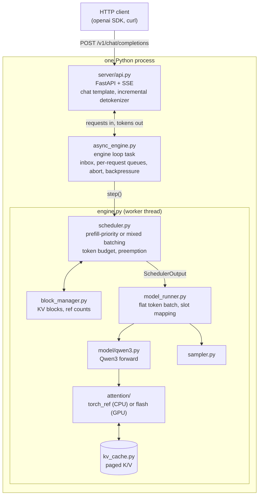
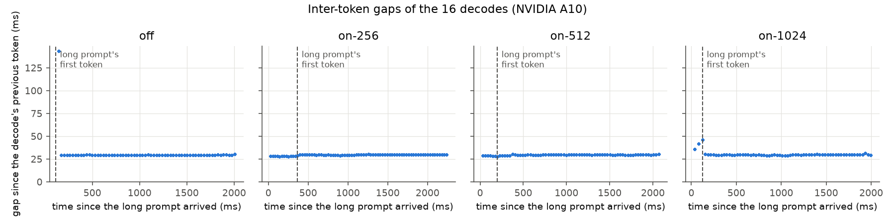

# stallfree

An online LLM serving engine for [Qwen3-0.6B](https://huggingface.co/Qwen/Qwen3-0.6B), written from
scratch in Python and PyTorch:

- a paged KV cache with a block manager and reference counts;
- continuous batching with recompute preemption;
- an asyncio engine loop and an OpenAI-compatible `/v1/chat/completions` endpoint with SSE
  streaming;
- **stall-free mixed batching** (after Sarathi-Serve): prefill chunks and decodes share each step
  under a token budget, so a long prompt no longer freezes the requests that are already
  generating. It is off by default and turned on with a flag.

Every token the engine produces is checked against Hugging Face transformers: exactly in fp32 on
CPU, and with a calibrated tolerance in bf16 on GPU. Single GPU, single model; no custom CUDA
kernels (PyTorch ops and FlashAttention-2 only).

**Status:** the engine, server, and mixed batching are complete and tested. The full latency
benchmark against vLLM (over HTTP, on an L40S) is in progress; the only performance numbers so far
are the in-process micro-benchmark below.

## What problem it solves

With prefill-priority scheduling, a newly arrived prompt is processed in a step of its own. Every
request that is already generating gets no token during that step, so its users see the output
pause; the longer the prompt, the longer the pause. Mixed batching gives each step a token budget,
schedules one token for every generating request first, and fills the rest of the budget with a
chunk of the new prompt, spreading a long prompt over several steps. The cost is that the long
request's first token comes later.

## Architecture



- `block_manager.py`, `scheduler.py`, `sequence.py`, and `server/protocol.py` import no torch; all
  GPU code is in `model/`, `attention/`, `kv_cache.py`, and `model_runner.py`.
- Only the loop task touches the engine. HTTP handlers post requests and aborts to an inbox and
  read tokens from per-request queues; the step itself runs in a worker thread so the event loop
  keeps serving while the GPU computes.
- Each step is a flat batch of tokens from many sequences (decodes and prefill chunks alike);
  attention reads K/V only through block tables, with the PyTorch reference backend on CPU and
  `flash_attn_varlen_func` with a paged block table on GPU.

Design choices, the options considered, and the evidence for each are in
[docs/decisions.md](docs/decisions.md).

## Correctness

| Check | Where | What it requires |
|---|---|---|
| Strict fp32 suite | CPU, in CI | Engine output identical, token for token, to Hugging Face greedy decoding on a small random Qwen3, with mixed batching off and on: batching, block boundaries, forced preemption, every prompt chunked, preemption in the middle of a chunked prefill |
| Scheduler and block manager contracts | CPU, in CI | Step-by-step plans, budget and FIFO rules, and random workloads checked against a scheduler-free reference; each component also went through mutation testing |
| bf16 margin rule | GPU (Modal) | On the real model, the engine may differ from Hugging Face only at a position where the reference's top-1/top-2 logit gap is at most τ = 0.5, a threshold calibrated on Hugging Face's own bf16 run-to-run differences |
| Teacher-forced check | GPU (Modal) | With the reference sequence fed in, the top-1 token matches at every position whose gap exceeds τ (1,451 of 1,451) |
| Server | CPU, in CI; GPU (Modal) | The official `openai` client against a real server: streaming equals non-streaming, usage, 8 concurrent streams, disconnect frees all KV blocks, 503 when full |

The CPU suite has 378 tests (`uv run pytest -m "not gpu"`); the GPU tests run on Modal. On an A10,
with every prompt chunked, the engine diverged from the reference on 17 of 32 prompts, all at
near-ties, while Hugging Face run with a different kernel, batch size, or precision diverges from itself
on 12 to 18 of the same 32 ([data](docs/data/margin_suite_mixed16.json)).

## Micro-benchmark: a long prompt arrives during 16 decodes

Sixteen requests are generating; a 3,000-token prompt arrives. Measured: the largest gap between
consecutive tokens of the 16 running requests, and the new request's time to first token (TTFT).



| config | max ITL (ms) | p99 ITL (ms) | median ITL (ms) | long TTFT (ms) | long prefill steps | steps | output tok/s |
|---|---|---|---|---|---|---|---|
| off | 143.3 (142.9-143.4) | 143.3 (142.9-143.4) | 29.5 (29.4-29.8) | 112.9 (112.7-113.2) | 1 | 65 | 543 (540-546) |
| on-256 | 30.0 (29.8-30.7) | 30.0 (29.8-30.7) | 29.7 (29.2-29.7) | 366.4 (359.8-368.1) | 13 | 76 | 572 (571-580) |
| on-512 | 30.6 (30.6-31.0) | 30.6 (30.6-31.0) | 29.7 (29.6-29.7) | 201.9 (200.0-202.1) | 7 | 70 | 572 (571-573) |
| on-1024 | 46.8 (46.5-46.9) | 46.8 (46.5-46.9) | 29.7 (29.6-29.8) | 125.1 (124.6-125.2) | 3 | 66 | 562 (560-564) |

Median (min-max) of 3 interleaved repeats after a warm-up, all configurations in one container on
one NVIDIA A10, Qwen3-0.6B in bf16 with FlashAttention. The table and plots are generated from the
[raw per-step and per-token timestamps](benchmarks/data/microbench/stall_a10_d93b769.json) by
`python -m benchmarks.microbench`; full details in
[benchmarks/results/microbench.md](benchmarks/results/microbench.md).

With a 512-token budget the largest gap drops from 143 ms to 31 ms, and the long request's TTFT
rises from 113 ms to 202 ms. What this does and does not show:

- **In-process.** The benchmark calls the engine directly, with no HTTP server and no async loop,
  so the only difference between rows is the scheduling policy. It is not an end-to-end latency
  measurement.
- **One GPU, one small model.** An A10 and a 0.6B model; other GPUs and models will give other
  numbers, and the best budget has to be measured for each.
- **Steps are dominated by per-step overhead.** Without CUDA graphs, a decode step for 16
  sequences takes about 29.5 ms, and adding a 496-token prefill chunk does not make it slower.
  That is why chunks look almost free here and why throughput is slightly higher with mixed
  batching on. An engine with much faster decode steps (vLLM uses CUDA graphs) would pay
  relatively more for each chunk.
- **The TTFT cost is real.** The long request waits 1.8 times as long for its first token at a
  512 budget, and 3.2 times at 256.
- **No comparison with vLLM yet.** That is the full benchmark, in progress.

## Known simplifications

- One GPU and one model (Qwen3 architecture); no tensor parallelism, quantization, prefix caching,
  or speculative decoding.
- No CUDA graphs, `torch.compile`, or custom kernels; see the gaps listed in
  [docs/decisions.md](docs/decisions.md#known-gaps-to-vllm-before-the-benchmark).
- KV block size 256, required by FlashAttention's paged mode (vLLM uses 16), so more memory sits
  unused in each sequence's last block.
- Recompute preemption only (no swapping to CPU memory).
- Chat completions only. `n > 1`, `stop`, `seed`, `tools`, logprobs, and penalties are rejected
  with a 400 naming the field. Sampling supports temperature and top-p.
- A non-streaming request keeps running if its client disconnects (streaming requests are
  cancelled).
- The Modal endpoint runs with mixed batching off; the flag is available on the command line.

## Running it

Requires [uv](https://docs.astral.sh/uv/) and Python 3.12.

```bash
uv sync
```

```bash
uv run pytest -m "not gpu"
```

The CPU tests use a small random Qwen3 built in the test and download no weights (the tokenizer
tests fetch the Qwen3 tokenizer files, not the weights, from the Hugging Face Hub on first use).

### Serve on CPU

Download the model (about 1.5 GB) and start the server with the PyTorch attention backend:

```bash
uv run hf download Qwen/Qwen3-0.6B --local-dir models/qwen3-0.6b
```

```bash
uv run python -m stallfree.server.api --model models/qwen3-0.6b --served-model-name Qwen/Qwen3-0.6B --device cpu --dtype float32 --block-size 16 --num-blocks 256 --max-model-len 1024 --enable-mixed-batching --max-num-batched-tokens 512
```

```bash
curl -N localhost:8000/v1/chat/completions -H 'Content-Type: application/json' -d '{"model": "Qwen/Qwen3-0.6B", "messages": [{"role": "user", "content": "Hi"}], "max_tokens": 32, "stream": true}'
```

Set `STALLFREE_API_KEY` to require a bearer key. Any OpenAI client works with
`base_url="http://localhost:8000/v1"`.

### Run on a GPU with Modal

Requires a [Modal](https://modal.com) account (`uv run modal setup`). Weights are downloaded once
into a Modal volume by a CPU-only function.

```bash
uv run modal run -m modal_apps.dev::download
```

```bash
uv run modal run -m modal_apps.dev::gpu_tests
```

```bash
uv run modal run -m modal_apps.dev::phase3_gpu --gpu A10
```

`gpu_tests` runs the GPU test suite; `phase3_gpu` runs the chunked bf16 margin suite and the
micro-benchmark above in one container and writes their data to `docs/data/` and
`benchmarks/data/microbench/`. To serve over HTTPS from Modal:

```bash
STALLFREE_API_KEY=<key> uv run modal serve -m modal_apps.serve
```

Stop it afterwards with `uv run modal app stop -y <app id>` and check `uv run modal app list`.

## Repository layout

```
src/stallfree/     engine, scheduler, block manager, model, attention, server
tests/unit/        component contracts (CPU)
tests/integration/ end-to-end against Hugging Face, and the HTTP server (CPU)
tests/gpu/         bf16 margin suite, flash vs reference, server concurrency (Modal)
benchmarks/        micro-benchmark harness, raw data, generated results
modal_apps/        Modal images and entry points
docs/              decisions.md and the data behind every GPU result
```

## Credits

- **Sarathi-Serve** — A. Agrawal et al., "Taming Throughput-Latency Tradeoff in LLM Inference with
  Sarathi-Serve", OSDI 2024 ([arXiv:2403.02310](https://arxiv.org/abs/2403.02310)). The stall-free
  mixed batching here follows its design.
- **PagedAttention / vLLM** — W. Kwon et al., "Efficient Memory Management for Large Language Model
  Serving with PagedAttention", SOSP 2023 ([arXiv:2309.06180](https://arxiv.org/abs/2309.06180)),
  and [vLLM](https://github.com/vllm-project/vllm), the reference point for the paged KV cache,
  the API behaviour, and the coming benchmark.
- **[nano-vllm](https://github.com/GeeeekExplorer/nano-vllm)** and
  **[mini-sglang](https://github.com/sgl-project/mini-sglang)** — read as references before
  designing this engine; no code is taken from them.
- **[Hugging Face transformers](https://github.com/huggingface/transformers)** — the correctness
  reference for every test.
- **[FlashAttention](https://github.com/Dao-AILab/flash-attention)** — the GPU attention kernel.

Licenses of dependencies and the model are listed in [THIRD_PARTY_NOTICES](THIRD_PARTY_NOTICES).
This project is MIT-licensed ([LICENSE](LICENSE)).
