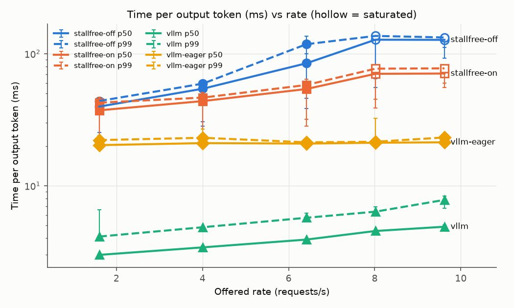
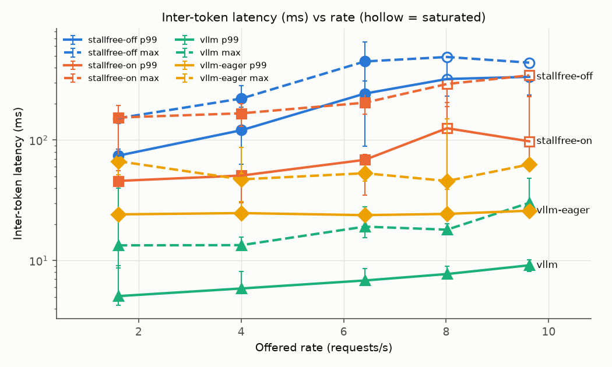
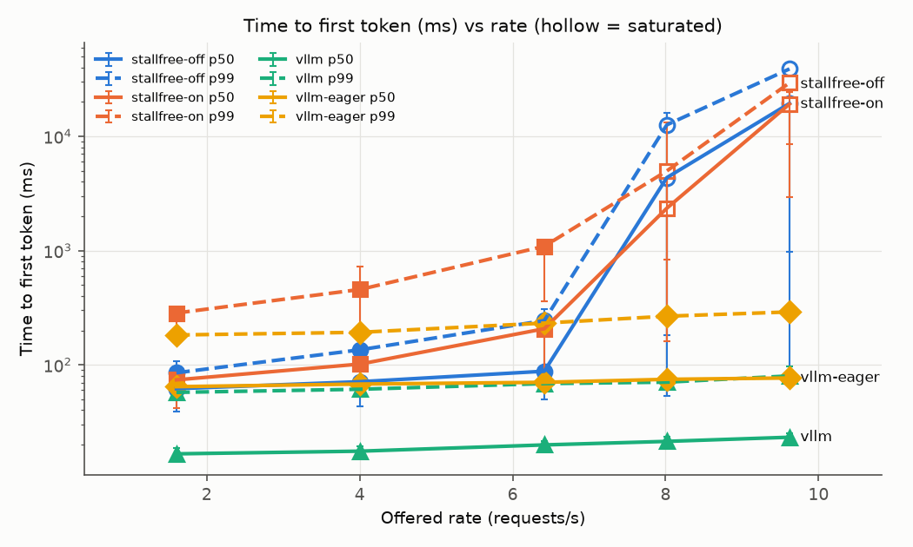
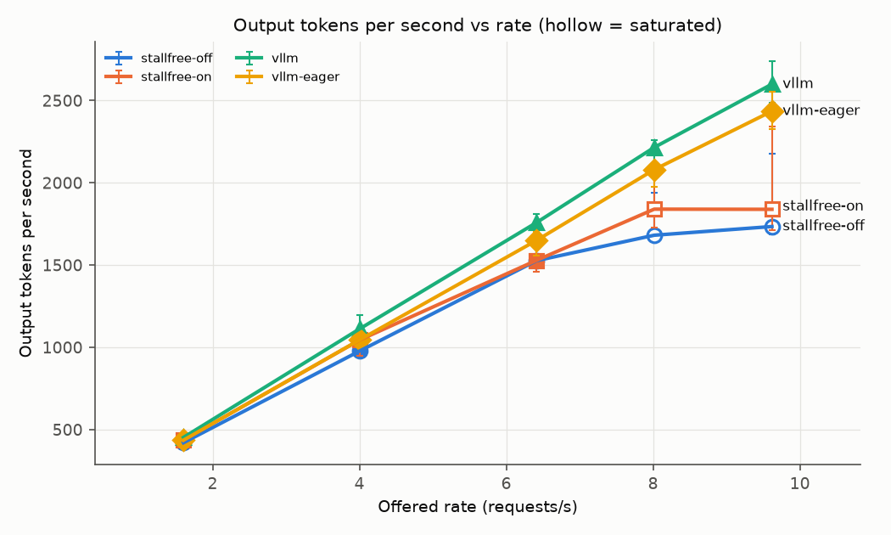

# Serving benchmark: stallfree against vLLM on one L40S

This compares stallfree, with mixed batching off and on, against vLLM 0.33.0 with its defaults
and with `--enforce-eager`, on Qwen3-0.6B in bf16 on one NVIDIA L40S. Every number here comes
from the raw data in [`benchmarks/data/`](data/). The tables are generated by
`python -m benchmarks.summarize` ([`results/sweep.md`](results/sweep.md)) and the plots by
`python -m benchmarks.plot` ([`plots/`](plots/)). A test checks that every table row quoted below
is identical to the generated one.

**The workload is designed to expose prefill stalls, not to model real traffic.** One request in
five has a long prompt (1,536 to 3,072 tokens) arriving while short requests decode, and every
request generates a fixed 64 to 512 tokens. On this workload, at every rate measured, vLLM is
faster than stallfree on every latency metric and has higher throughput. Mixed batching does make
stallfree's own decode latency steadier, which is what it was built for.

## Setup

- **Hardware:** one Modal L40S container per system and repeat, with 8 CPU cores and 32 GiB of
  memory. The server and the load generator are separate processes on `localhost`.
- **Software:** stallfree runs on torch 2.10.0+cu130 with flash-attn 2.8.3. vLLM 0.33.0 runs in
  its official image (torch 2.14.0+cu130). Model revision `c1899de`.
- **Matched settings:** `max_model_len` 4096, `max_num_seqs` 256, 0.9 GPU memory, and no prefix
  caching. vLLM and stallfree-on both use a 512-token step budget; stallfree-off caps prefill
  steps at 4096 tokens. Everything else in vLLM is its default (CUDA graphs, `torch.compile`,
  separate API-server and engine-core processes). `vllm-eager` adds only `--enforce-eager`.
- **Workload:** Poisson arrivals. Prompts are sampled from a public-domain novel, with lengths
  counted after the chat template and checked against the server's own count. Requests use
  greedy decoding with `ignore_eos`.
- **Measurement:** each point has a 30 s warm-up, then at least 300 requests and 120 s of
  arrivals. There are 3 repeats with trace seeds 1, 2, 3, and every system replays byte-identical
  requests (trace hashes are in `results/sweep.md`).
- **Rates:** 0.2, 0.5, 0.8, 1.0 and 1.2 times stallfree-off's closed-loop saturation throughput
  of 8.02 req/s, i.e. 1.60, 4.01, 6.41, 8.02 and 9.62 req/s.
- **Sanity checks, all 60 runs:**
  - zero failed requests;
  - zero prompt-token mismatches with the server's count;
  - zero `ignore_eos` violations;
  - about 1.000 tokens per streamed chunk;
  - the load generator never averaged more than 27% of one core (peak 61%), far below the 80%
    flag.

Methodology details and every choice behind them are in
[`docs/decisions.md`](../docs/decisions.md#phase-4--benchmark).

## Results at 0.8 x saturation (6.41 req/s)

Median of three repeats, with min-max in brackets. TTFT, TPOT and ITL are in ms; E2E is in s.

| system | rate (req/s) | repeats | TTFT p50 (ms) | TTFT p99 (ms) | TPOT p50 (ms) | TPOT p99 (ms) | ITL p99 (ms) | ITL max (ms) | E2E p50 (s) | output tok/s | saturated |
|---|---|---|---|---|---|---|---|---|---|---|---|
| stallfree-off | 6.41 (0.8x) | 3 | 87.9 (49.7-97.4) | 244.0 (90.9-306.1) | 84.5 (38.5-100.1) | 117.9 (45.9-135.9) | 243.1 (88.8-310.1) | 449.3 (215.2-652.9) | 25.0 (10.3-26.6) | 1527.1 (1488.3-1551.3) | no |
| stallfree-on | 6.41 (0.8x) | 3 | 206.8 (67.6-264.8) | 1090.8 (359.6-1207.4) | 54.0 (28.3-55.3) | 57.9 (31.8-63.9) | 68.6 (35.0-76.2) | 204.3 (163.4-245.3) | 14.8 (8.4-15.7) | 1529.1 (1461.3-1690.5) | no |
| vllm | 6.41 (0.8x) | 3 | 19.9 (19.4-21.3) | 68.5 (65.0-78.7) | 3.9 (3.9-4.0) | 5.7 (5.7-6.2) | 6.8 (6.7-8.6) | 19.1 (15.5-28.1) | 1.1 (1.1-1.2) | 1758.7 (1675.5-1810.1) | no |
| vllm-eager | 6.41 (0.8x) | 3 | 70.3 (69.1-72.9) | 231.9 (230.4-243.2) | 20.9 (20.7-21.3) | 21.3 (21.2-22.7) | 23.8 (23.8-24.6) | 53.1 (45.5-54.2) | 5.8 (5.8-6.3) | 1650.3 (1559.1-1701.1) | no |

The output tok/s column divides by a window that includes the drain after the last arrival, so a
system with long end-to-end latency reads lower even when it is not saturated.






The full table (all rates), the per-run checks, and the CPU use per run are in
[`results/sweep.md`](results/sweep.md).

### Overload (1.2 x, 9.62 req/s)

| system | rate (req/s) | repeats | TTFT p50 (ms) | TTFT p99 (ms) | TPOT p50 (ms) | TPOT p99 (ms) | ITL p99 (ms) | ITL max (ms) | E2E p50 (s) | output tok/s | saturated |
|---|---|---|---|---|---|---|---|---|---|---|---|
| stallfree-off | 9.62 (1.2x) | 3 | 19429.9 (75.7-24810.2) | 38940.2 (982.5-44401.7) | 127.2 (92.6-128.7) | 132.6 (111.7-138.1) | 334.8 (236.9-352.5) | 439.1 (433.6-441.9) | 56.9 (23.9-57.4) | 1734.5 (1687.3-2176.4) | 2/3 |
| stallfree-on | 9.62 (1.2x) | 3 | 19190.4 (2939.9-24439.6) | 29420.4 (8479.8-34051.1) | 70.7 (55.6-72.4) | 77.4 (60.0-78.5) | 97.7 (67.2-228.2) | 344.4 (230.8-363.1) | 37.6 (18.2-42.4) | 1839.2 (1711.1-2340.1) | 3/3 |
| vllm | 9.62 (1.2x) | 3 | 23.2 (22.6-24.9) | 79.9 (73.0-96.9) | 4.9 (4.7-5.0) | 7.8 (6.7-8.4) | 9.1 (8.1-10.1) | 30.1 (27.3-48.4) | 1.4 (1.3-1.5) | 2599.9 (2487.0-2740.4) | no |
| vllm-eager | 9.62 (1.2x) | 3 | 76.7 (76.4-84.4) | 290.3 (280.1-299.1) | 21.3 (21.1-21.8) | 23.2 (21.6-23.5) | 25.9 (24.3-26.0) | 62.8 (59.9-69.4) | 6.1 (5.9-6.4) | 2435.8 (2326.4-2553.7) | no |

stallfree is overloaded at this rate: queues grow for the whole run, so TTFT reaches tens of
seconds. Neither vLLM configuration is saturated at any rate in the sweep.

### Saturation throughput (closed loop, 256 clients)

| system | concurrency | requests/s | output tokens/s | requests finished in window |
|---|---|---|---|---|
| stallfree-off | 256 | 8.02 | 2259 | 962 |
| vllm | 256 | 18.22 | 5139 | 2186 |

Both saturation runs ran on the same host type (driver 610.57.04), where vLLM finishes 2.3 times
as many requests per second. vLLM's figure is reported for reference only; it is not a sweep
point.

### stallfree-on token budget at 0.8 x

| budget (tokens) | repeats | TTFT p50 (ms) | TTFT p99 (ms) | TPOT p50 (ms) | ITL p99 (ms) | ITL max (ms) | E2E p50 (s) |
|---|---|---|---|---|---|---|---|
| 256 | 3 | 14531.2 (5791.6-16881.7) | 24790.5 (16462.5-24936.0) | 47.1 (45.8-49.3) | 58.7 (53.3-61.7) | 206.0 (191.7-227.1) | 28.7 (20.9-30.4) |
| 512 | 3 | 206.8 (67.6-264.8) | 1090.8 (359.6-1207.4) | 54.0 (28.3-55.3) | 68.6 (35.0-76.2) | 204.3 (163.4-245.3) | 14.8 (8.4-15.7) |
| 1024 | 3 | 111.9 (107.2-112.7) | 361.5 (339.0-367.7) | 53.0 (51.5-54.8) | 63.9 (63.8-84.1) | 199.9 (199.0-218.7) | 14.4 (14.3-15.6) |
| 2048 | 3 | 125.1 (109.6-187.0) | 284.7 (261.4-531.3) | 60.1 (54.5-90.6) | 97.1 (70.1-245.7) | 256.9 (232.5-358.8) | 17.8 (15.4-23.4) |

- **256 tokens:** too small at this rate. After the decodes, too little of each step is left for
  prefill, so the queue grows (TTFT p50 14.5 s).
- **1,024 tokens:** half the TTFT of 512 at a similar ITL p99. All three 1,024 runs, and two of
  the three 512 runs, ran on the same host type, so this comparison holds on like hardware.
- **2,048 tokens:** let ITL p99 reach 97 ms.

On the L40S, 1,024 is therefore a better default than the 512 measured on the A10. The sweep used
512, as fixed beforehand.

## Findings

### 1. Mixed batching inside stallfree

At 0.8 x saturation, turning mixed batching on changes stallfree's numbers as follows:

| metric | off | on | change |
|---|---|---|---|
| ITL p99 | 243 ms | 69 ms | 3.5x lower |
| ITL max | 449 ms | 204 ms | lower |
| TPOT p50 | 84.5 ms | 54.0 ms | lower |
| TTFT p50 | 88 ms | 207 ms | higher |
| TTFT p99 | 244 ms | 1,091 ms | higher |

This is the trade the design makes: long prompts no longer stall the decodes, and in exchange
each new request waits longer for its first token. At 1.0 x and above, both configurations are
overloaded on the slower host type (see "Host types" below).

### 2. The gap to vLLM

At 0.8 x, vLLM's median TPOT is 3.9 ms against stallfree-on's 54.0 ms, 14 times faster. The gap
splits into two parts:

- **vLLM eager against stallfree-on: 20.9 against 54.0 ms, 2.6 times.** Both run without CUDA
  graphs, so this part is the rest of the engine: process layout, kernels, and per-step overhead.
- **vLLM with CUDA graphs against vLLM eager: 3.9 against 20.9 ms, 5.4 times.** Same scheduler,
  same kernels; only the graph replay differs.

TTFT shows the same pattern: 20 ms (vLLM), 70 ms (eager), and 207 ms (stallfree-on) at the median.

### 3. Where stallfree's time goes: CPU-bound in one process

**CPU and GPU utilisation** (from the per-second CPU samples in every run):

| system | server CPU | GPU busy |
|---|---|---|
| stallfree (every run, every rate) | 99-102% of one core | 24-57% |
| vLLM (default) | 93-141% | 96-100% from 0.5 x up (about 70% at 0.2 x) |
| vLLM eager | 136-162% | 21-57% |

stallfree's server never uses more than one core, and the GPU is idle for half of each step or
more: the engine is limited by Python on the CPU.

**py-spy profile.** The stallfree-on server was profiled at 0.8 x for 60 s, with native frames
([`results/profile.md`](results/profile.md), raw profile in `data/profile/`). That run is not
counted in the results above. It shows where the one core goes:

| component | share of the server's CPU |
|---|---|
| model forward | 34.2% |
| batch metadata, sampling, scheduler, engine step | 7.8% |
| prompt tokenization (chat template and tokenizer) | 22.4% |
| HTTP and SSE | 17.3% |
| asyncio event loop | 16.5% |
| detokenization | 1.1% |

- **Inside model forward,** the innermost frame is PyTorch's C++ dispatch in 42% of samples,
  malloc/memcpy/locks in 19%, the CUDA driver and runtime (kernel launch) in 18%, and Python in
  17%. All of this is host-side work spent issuing the many small kernels of 28 layers, one by
  one, while the GPU waits. It is exactly the work a CUDA graph replaces with one launch, which
  matches the 5.4x vLLM measures between its eager and graph modes.
- **Everything on the asyncio thread** (tokenization, HTTP/SSE, the event loop) takes 58% of the
  process's CPU, and the threads that run engine steps take 42%. The step threads spend a further
  12% of their samples waiting for the GIL.
- **vLLM runs the API server in a separate process** (8-28% of a core in the eager runs) from
  the engine core (128-138%). Its engine therefore has a full core or more to itself, where
  stallfree's engine gets well under half a core and shares the GIL. That alone could account for
  a factor of about two. It is consistent with the 2.6x gap to vLLM eager but does not prove it:
  kernel choices and vLLM's other per-step optimisations are not separated by this benchmark.

**Caveats on the profile:**
- Sampling with native frames pauses the process 100 times a second. That slowed the profiled
  run to a TPOT of 57 ms against 28 ms unprofiled on the same host type, and pushed it into
  saturation. The shares come from that slowed server.
- A second, non-blocking, Python-only profile
  ([`results/profile_nonblocking.md`](results/profile_nonblocking.md)) slowed the server less
  (74 against 55 ms on its host type). It agrees that model forward is about 35% of the CPU.
- That Python-only profile cannot see time spent in the Rust tokenizer, and in this sandbox it
  counts the event loop's idle `epoll` waits as running. So it is not used for the other shares.

### 4. Host types

Modal placed containers on two kinds of host, told apart by their NVIDIA driver version
(610.57.04 and 620.70.06). stallfree is 1.8 to 2.4 times faster per token on the 610 hosts. For
example, at 0.8 x stallfree-on's TPOT is 28.3 ms there against 54.0-55.3 ms on the 620 hosts.

vLLM with CUDA graphs is the same on both (3.9-4.0 ms), as expected for a GPU-bound engine. Every
vLLM-eager run landed on 620 hosts. Driver version and host CPU are confounded here; the CPU model
was not recorded in these runs and is from now on.

Consequences:
- In each stallfree row, one repeat ran on a 610 host and two on 620 hosts. The medians are
  therefore 620-host values, the same host type as all of vLLM eager. The min-max ranges in the
  stallfree rows are this host split, not run-to-run noise.
- The saturation run that set the rates ran on a 610 host. On 620 hosts stallfree saturates
  earlier, which is why two of three repeats are saturated at 1.0 x.
- `results/sweep.md` has a table split by host type.

### 5. Global stalls in stallfree that are not explained yet

stallfree's largest inter-token gaps are global: every stream pauses at the same moment. For
stallfree-on at 0.2 x they last 150-190 ms on 620 hosts and 47 ms on the 610 host.

They do not line up with long-prompt arrivals. Only 7% of stallfree-on's top 0.1% gaps contain a
long-prompt arrival, against 3% for random windows of the same length. Candidates are Python
garbage collection, growth of the CUDA caching allocator, and event-loop blocking. Telling them
apart needs per-step timing inside the server, which is not recorded. They set stallfree-on's ITL
max (about 200 ms) even at low load. vLLM's ITL max is 13-30 ms at every rate.

## What this does not show

- **One GPU and one small model.** With 0.6B parameters, per-step overhead is a large share of
  each step, which favours CUDA graphs and hurts a Python engine more than a larger model would.
- **A workload built to produce stalls.** Other prompt and output mixes could shift every number.
- **Rates set by stallfree.** All of them are light load for vLLM, so its saturation behaviour is
  not part of the sweep.
- **Mixed host types.** Results are grouped by host type above, but each host type has only one
  or two repeats per stallfree point.

## Reproducing

```bash
uv run modal run -m modal_apps.bench::saturation
uv run modal run -m modal_apps.bench::sweep
uv run modal run -m modal_apps.bench::budgets
uv run modal run -m modal_apps.bench::profile
uv run python -m benchmarks.summarize benchmarks/data --out benchmarks/results
uv run python -m benchmarks.plot benchmarks/data --out benchmarks/plots
uv run python -m benchmarks.profile_summary benchmarks/data/profile/stallfree-on/r0.8x/seed1.pyspy.txt.gz --out benchmarks/results/profile.md
```

The first four need a Modal account and L40S time: about 4 container-hours in all for this sweep.
